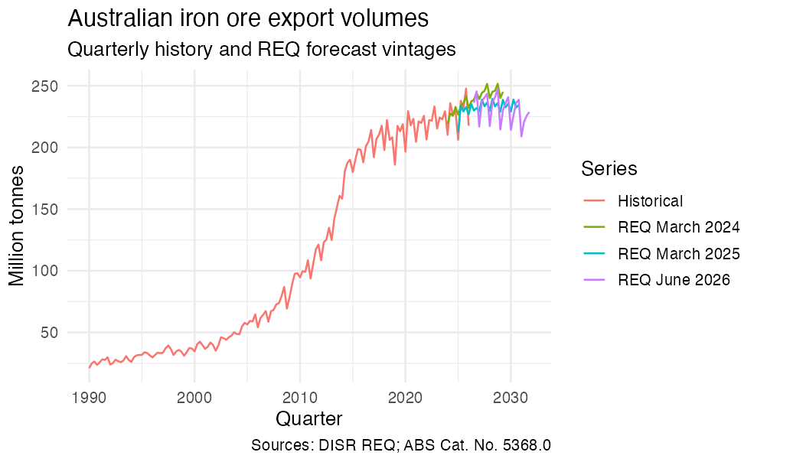

readreq
================

- [readreq](#readreq)
  - [Coverage: editions, source assets and observation
    dates](#coverage-editions-source-assets-and-observation-dates)
  - [What you can do](#what-you-can-do)
  - [Installation](#installation)
  - [First success, entirely offline](#first-success-entirely-offline)
  - [Retrieve and chart a time
    series](#retrieve-and-chart-a-time-series)
  - [The observation contract](#the-observation-contract)
  - [Common workflows](#common-workflows)
  - [Network, credentials and cache
    behaviour](#network-credentials-and-cache-behaviour)
  - [Scope and limitations](#scope-and-limitations)
  - [Author, citation, source attribution and
    licensing](#author-citation-source-attribution-and-licensing)
  - [Documentation, support and
    contributing](#documentation-support-and-contributing)

# readreq

`readreq` turns the official Australian Government *Resources and Energy
Quarterly* (REQ) releases into tidy, provenance-rich observations. It is
for analysts who need to select an exact edition, preserve source tables
and footnotes, compare revisions, and replay a cached result without
relying on a live website.

It combines an edition-specific source catalogue, content-addressed
downloads, structured workbook parsers, validation, and vintage analysis
in one reproducible workflow. Every observation retains its source
edition, table, hash, period semantics, status, unit, and parser
version.

> **Status:** development release and pre-CRAN release candidate. It has
> not been submitted to or accepted by CRAN. The checked-in catalogue
> covers 59 audited editions from September 2011 through June 2026.

## Coverage: editions, source assets and observation dates

**REQ itself begins with the September 2011 edition.** The installed
catalogue contains every audited REQ edition from that inaugural release
through June 2026: September and December 2011, all four quarterly
editions in every year from 2012 through 2025, and June 2026. That is 59
editions in total—14 March, 15 June, 15 September and 15 December
editions—not a March-only collection. There is no 2010 or 2000 REQ
edition. Publications before September 2011 belong to predecessor
ABARE/ABARES product families and are outside this package’s REQ source
contract; they are not missing REQ editions.

Edition dates are different from observation dates. Historical tables
inside a supported edition can contain observations from 2000 or
earlier. For example, series in the June 2026 historical workbook have
different start dates: the quarterly iron ore export-volume series
charted below begins in 1990-Q1, the monthly thermal-coal benchmark
begins in 2000, and the monthly iron-ore benchmark begins in 2008.
Always inspect `period_start`, `period_end` and the source metadata for
the selected series rather than treating the edition date as the start
of its observations. Use `req_series_catalog()` to inspect the available
series and periods for an edition.

Source-asset coverage is also edition-specific. Of the 59 editions, 57
have at least one structured workbook surface and two have an audited
report fallback. The exact role combinations are:

- 36 editions with forecast, historical and report assets;
- 14 with forecast and report assets;
- one forecast-only edition and one forecast-plus-historical edition;
- four early editions with report, statistical and commodity workbooks;
- the September 2011 edition with those early assets plus historical
  statistical and commodity companions; and
- two report-only editions (`req-2011-12` and `req-2013-03`) with a
  narrower Key macroeconomic assumptions fallback.

Inspect `asset_roles` and the edition-specific URLs returned by
`list_req_releases()` before choosing a reader. Adding a new REQ edition
is usually straightforward when its layout matches an audited profile,
but it still requires exact source URLs, hashes, validation evidence and
tests. Adding pre-September-2011 predecessor products would be a
separate extension: their sources, rights, taxonomy and parser contracts
must be researched and audited rather than appended as if they were REQ
editions.

## What you can do

| User job | Main functions | Result |
|:---|:---|:---|
| Find an exact edition | `list_req_releases()` | A release manifest with dates, source URLs, asset roles, support status and release identity |
| Download and replay source assets | `download_req_release()`, `req_cache_dir()` | Immutable, content-addressed raw assets and parsed cache entries |
| Read one source surface | `read_req_forecasts()`, `read_req_history()` | Forecast or historical observations, with semantic filters and reported/canonical views |
| Read a coherent edition | `read_req()` | Forecast, historical or combined observations in reported or policy-controlled current view |
| Find stable series and source tables | `req_series_catalog()`, `req_source_catalog()` | Semantic series metadata and the supported table/source map |
| Compare vintages | `compare_req_vintages()`, `req_history_revision()`, `req_forecast_revision()`, `req_forecast_error()` | Explicit historical revisions, forecast revisions and forecast errors |
| Check a release and inspect contracts | `validate_req_release()`, `req_observation_schema()`, `req_release_manifest_schema()`, `req_raw_asset_manifest_schema()` | Validation diagnostics and machine-readable output contracts |
| Interpret statuses, missingness and source terms | `req_status()`, `req_missing_reason()`, `req_attribution()` | Controlled vocabularies and attribution guidance |

Thirty-eight older landing sources use HTTPS Australian Government Web
Archive endpoints; the remaining 21 use current department pages.
`latest` selects the newest edition in the installed catalogue. Exact
`req-YYYY-MM` identifiers keep an analysis pinned across catalogue
updates.

## Installation

Install the development version from GitHub:

``` r
install.packages("pak")
pak::pak("chartwell-macro/readreq")
```

If the repository is access-restricted, authenticate your GitHub client
before installing. Source retrieval then uses the catalogue’s public
endpoints without a data-source credential or API key.

`readreq` is **not on CRAN yet**. After a CRAN release is accepted, the
standard installation command will be:

``` r
install.packages("readreq")
```

## First success, entirely offline

The package includes a small, synthetic workbook fixture with the
audited structural patterns needed by the parser. This path exercises
the same public reader used for downloaded workbooks while keeping the
example fully offline. The fixture is package-authored demonstration
data rather than official REQ product data.

``` r
library(readreq)

releases <- list_req_releases(supported_only = TRUE)
cat(sprintf(
  "editions: %d\nearliest: %s\nlatest: %s\n",
  nrow(releases),
  releases$release_id[[which.min(releases$release_date)]],
  releases$release_id[[which.max(releases$release_date)]]
))
#> editions: 59
#> earliest: req-2011-09
#> latest: req-2026-06

fixture <- system.file(
  "extdata", "readreq-example-forecast.xlsx", package = "readreq",
  mustWork = TRUE
)

example_cache <- file.path(tempdir(), "readreq-readme-cache")
forecast <- read_req_forecasts(
  fixture,
  view = "canonical",
  cache_dir = example_cache
)

cat(sprintf(
  "rows: %d\ncolumns: %d\n", nrow(forecast), ncol(forecast)
))
#> rows: 152
#> columns: 35
forecast[seq_len(min(3L, nrow(forecast))),
  c("period", "period_status", "unit", "value")]
#>   period          period_status unit value
#> 1   2024 published-unclassified   kt    10
#> 2   2025               estimate   kt    11
#> 3   2026               forecast   kt    12
```

The exact output values above come from the packaged synthetic fixture.
For official data, replace `fixture` with an exact release ID after
downloading its assets, or pass a local workbook that matches an audited
source profile.

## Retrieve and chart a time series

This real example puts the complete quarterly iron ore export-volume
history available in the June 2026 workbook on one chart with forecasts
from the March 2024, March 2025 and June 2026 REQ editions. The
historical line contains 145 observations from 1990-Q1 through 2026-Q1;
the three forecast vintages show how the outlook changed. The first read
of each official workbook downloads it to the package cache; later calls
replay the exact cached asset.

``` r
releases <- list_req_releases(supported_only = TRUE)
vintage_ids <- c("req-2024-03", "req-2025-03", "req-2026-06")
releases[
  releases$release_id %in% vintage_ids,
  c("release_id", "release_date", "asset_roles")
]

source_catalog <- req_source_catalog()
source_catalog[
  source_catalog$table_id %in% c(
    "history_commodity_iron_ore_steel",
    "forecast_quarterly_export_volumes"
  ),
  c("source_dataset", "source_label", "table_id", "parser_family")
]

history <- read_req_history(
  "req-2026-06",
  tables = "history_commodity_iron_ore_steel",
  commodities = "iron_ore_steel",
  concepts = "exports_quantity_iron_ore_b_total_iron_ore",
  geography = "Australia",
  frequency = "quarterly",
  view = "canonical",
  cache_dir = req_cache_dir()
)

history <- history[
  !is.na(history$value), c("period_start", "value")
]
history$value <- history$value / 1000
history$series <- "Historical"

vintage_labels <- setNames(
  c("REQ March 2024", "REQ March 2025", "REQ June 2026"),
  vintage_ids
)
forecasts <- do.call(rbind, lapply(vintage_ids, function(id) {
  x <- read_req_forecasts(
    id,
    sheets = "forecast_quarterly_export_volumes",
    commodities = "iron_ore",
    concepts = "export_volume",
    geography = "Australia",
    view = "canonical",
    cache_dir = req_cache_dir()
  )
  x <- x[
    !is.na(x$value) & x$period_status %in% c("forecast", "projection"),
    c("period_start", "value")
  ]
  x$series <- vintage_labels[[id]]
  x
}))

chart_data <- rbind(history, forecasts)
chart_data <- chart_data[order(chart_data$series, chart_data$period_start), ]
chart_data$series <- factor(
  chart_data$series, levels = c("Historical", unname(vintage_labels))
)
```

``` r
if (requireNamespace("ggplot2", quietly = TRUE)) {
  ggplot2::ggplot(
    chart_data,
    ggplot2::aes(
      x = period_start, y = value, colour = series, group = series
    )
  ) +
    ggplot2::geom_line() +
    ggplot2::labs(
      title = "Australian iron ore export volumes",
      subtitle = "Quarterly history and REQ forecast vintages",
      x = "Quarter",
      y = "Million tonnes",
      colour = "Series",
      caption = "Sources: DISR REQ; ABS Cat. No. 5368.0"
    ) +
    ggplot2::theme_minimal(base_size = 13)
}
```

<figure>

<figcaption aria-hidden="true">Single line chart of Australian quarterly
iron ore export volumes: the full 1990-Q1 to 2026-Q1 history and
forecast paths from the March 2024, March 2025 and June 2026 REQ
editions.</figcaption>
</figure>

The checked-in figure was generated from this exact public-API workflow
so the README, vignette and CRAN build remain deterministic and offline;
the official workbooks and extracted rows are not bundled. History is
taken from the June 2026 historical workbook and converted from kt to
million tonnes; only rows marked `forecast` or `projection` are retained
for each forecast vintage. The table notes credit the Australian Bureau
of Statistics (ABS), DISR and other named sources. See the [March
2024](https://www.industry.gov.au/publications/resources-and-energy-quarterly-march-2024),
[March
2025](https://www.industry.gov.au/publications/resources-and-energy-quarterly-march-2025)
and [June
2026](https://www.industry.gov.au/publications/resources-and-energy-quarterly-june-2026)
edition pages for the workbooks and source terms. Use
`req_series_catalog()` for broader interactive exploration.

## The observation contract

All three readers return a base `data.frame` with the same 35 columns.
The authoritative machine-readable description is returned by
`req_observation_schema()` and is also installed under `inst/schema/`.

``` r
names(req_observation_schema())
```

The columns, in order, are:

``` text
product, release_id, release_date, dataset, source_dataset, source_asset,
source_sheet, table_id, table_title, record_role, geography_type, geography,
commodity, concept, period, period_start, period_end, period_basis,
period_status, status_source, price_basis, currency, unit, value, raw_value,
missing_reason, footnote_codes, source_note, series_id, observation_key,
retrieved_at, sha256, parser_version, section, frequency
```

Character fields retain labels and provenance. `release_date`,
`period_start` and `period_end` are `Date`; `retrieved_at` is `POSIXct`;
`value` is numeric; and `footnote_codes` is a list column of character
vectors. `raw_value` keeps the source token. A source marker such as
unavailable, confidential or suppressed remains a numeric `NA` in
`value` with an explicit `missing_reason`, preserving the distinction
between missingness and zero.

`series_id` identifies a semantic series across periods and vintages.
`observation_key` adds the target period. Source rows use `record_role`
values such as `canonical` and `supporting`; an unresolved current-view
disagreement can add `conflict`. The `reported`, `canonical` and
`current` choices are view arguments, not `record_role` values. Rows
retain the source release, asset, sheet, table, source hash and parser
version. Readers may attach a `canonical_selection` data frame
containing the selected observation keys, presentation counts, policy
version and selection reason.

## Common workflows

### Choose an edition and inspect its assets

The release catalogue is checked in with the package, so browsing the
audited set is deterministic and offline:

``` r
releases <- list_req_releases(supported_only = TRUE)
releases[order(releases$release_date),
  c("release_id", "release_date", "support_status", "support_note")]
```

Use an exact `req-YYYY-MM` identifier for reproducible work. Use
`latest` only when an analysis is intended to follow the newest row
supplied by future installed package/catalogue updates.

### Download once, then read from the cache

``` r
cache_dir <- req_cache_dir()

download_req_release(
  "req-2026-06",
  assets = c("forecast", "historical"),
  cache_dir = cache_dir
)

reported <- read_req(
  "req-2026-06",
  view = "reported",
  cache_dir = cache_dir
)
current <- read_req(
  "req-2026-06",
  view = "current",
  cache_dir = cache_dir
)
```

`reported` preserves admitted source presentations. `current` applies
the package’s versioned precedence policy to combine forecast and
historical surfaces. Use `reported` for source reconciliation. Use
`current` when one policy-selected value per observation is required,
after confirming that its `conflicts` attribute has no unresolved rows.
Source provenance is retained in either view.

### Read and filter one workbook surface

The readers accept an exact release ID, `latest`, a named local release
bundle, or a local workbook path. Filters are semantic and are applied
after the source structure has been identified:

``` r
iron_ore <- read_req_forecasts(
  "req-2026-06",
  commodities = "Iron ore",
  view = "canonical"
)

monthly_history <- read_req_history(
  "req-2026-06",
  frequency = "monthly",
  view = "canonical"
)
```

For an already downloaded workbook, use a platform-neutral path rather
than renaming or editing the file:

``` r
read_req_forecasts(
  "/absolute/path/to/forecast-data.xlsx",
  cache_dir = file.path(tempdir(), "readreq-local-cache")
)
```

Local files match an audited structural profile. The parser raises typed
conditions for unknown sheets, unclaimed numeric cells and ambiguous
periods, keeping structural changes visible to the analyst.

### Inspect series, source tables and validation

``` r
series <- req_series_catalog("req-2026-06", data = "forecast")
source_tables <- req_source_catalog()

validation <- validate_req_release("req-2026-06")
stopifnot(validation$valid)
```

Persist the exact `release_id`, source hashes and package version with
any derived result. `validate_req_release()` returns mapping, count,
anomaly and conflict diagnostics rather than only a pass/fail flag.

### Compare revisions and forecast errors

Vintage operations work on observations from multiple releases. They
preserve the old and new release IDs, dates, statuses, values, units,
source sheets and source hashes in their comparison output:

``` r
vintages <- do.call(rbind, lapply(
  c("req-2025-12", "req-2026-06"),
  read_req,
  view = "current"
))

history_changes <- req_history_revision(vintages)
forecast_changes <- req_forecast_revision(vintages)
errors <- req_forecast_error(vintages, realisation = "first")

all_comparisons <- compare_req_vintages(
  releases = c("req-2025-12", "req-2026-06"),
  comparison = "forecast_revision"
)
```

`req_forecast_error()` accepts `realisation = "first"` or
`"latest_revised"`. Use `req_forecast_revision()` for forecast revisions
and `req_history_revision()` for historical revisions; each operation
preserves the appropriate comparison semantics.

## Network, credentials and cache behaviour

- `list_req_releases()` reads the installed, audited catalogue and does
  not need the network. For a string release ID,
  `download_req_release()` uses the bundled HTTPS asset URLs and
  validates their bytes before promotion into the cache. A supplied
  one-row manifest is used as supplied and can identify a local or
  custom URL; the `readreq.transport` option supports controlled custom
  transports used by tests and specialised workflows.
- The default cache is `req_cache_dir()`, backed by
  `tools::R_user_dir("readreq", "cache")`. Raw snapshots are immutable
  and content-addressed by release and SHA-256. Parsed entries include
  the source hash, parser version, view and selection, so an exact
  cached release can be replayed offline.
- A cache is complete only when it contains every asset needed for the
  request. An incomplete cache raises a typed error rather than
  returning a partial edition. A local workbook path is the simplest
  fully offline input.
- `refresh = TRUE` re-fetches or refreshes source data while preserving
  prior raw hashes; it does not delete old snapshots. There is no
  automatic cache pruning or cleanup API. The default cache can grow as
  immutable versions accumulate. Use
  `list.files(req_cache_dir(), recursive = TRUE)` to inspect it, and
  remove the package-specific directory manually only when no `readreq`
  process is using it and you intentionally want to discard its
  snapshots.
- For bounded tests or projects, supply `cache_dir = tempdir()` or an
  already expanded absolute path. Caller-supplied paths are used as
  supplied; use `req_cache_dir()`, `tempdir()`, or `path.expand()`
  before passing a path, rather than relying on a literal `"~"` path.
- No installation or startup download occurs, and the package does not
  read or send credentials. Network access occurs only for asset
  retrieval that a requested workflow cannot satisfy from a local input
  or exact cache.

The parser uses one worker by default. If you opt into parallel parsing
with `options(readreq.workers = 2L)`, keep the setting at two or fewer
workers and use the default one worker on platforms where
`parallel::mclapply()` is not available (notably Windows). This keeps
memory and CRAN resource use bounded.

## Scope and limitations

`readreq` focuses on the audited REQ structures in the installed
catalogue. The project is independently maintained and has no Australian
Government affiliation or endorsement; the official REQ reports and
workbooks remain the authoritative publications. Arbitrary spreadsheets
and unrelated energy datasets are outside the package’s scope. The
parser reports a structural change when an otherwise valid Excel
workbook no longer matches its audited table layout, period labels,
units or data regions.

| Symptom | What it means | What to do |
|:---|:---|:---|
| Discovery or download error | The official page or requested asset was unavailable, changed or incomplete | Check the exact `release_id`, inspect the condition class, and retry with `refresh = TRUE` when online |
| `req_asset_missing_error` | The selected edition has no admitted asset for the requested role | Inspect `list_req_releases()$asset_roles`; the 2011-12 and 2013-03 editions are report fallbacks |
| `req_workbook_schema_error` or `req_sheet_parse_error` | Workbook structure or a sheet no longer matches its audited profile | Keep the original file, record its URL/hash, and report the structural change; do not rename sheets or drop cells to bypass the error |
| `req_period_parse_error` or `req_unit_conflict_error` | Period or unit semantics are ambiguous | Preserve the raw labels and provide a reduced synthetic reproduction when reporting the issue |
| `req_stitch_conflict_error` | Equal-priority rows disagree while building the current view | Inspect the reported rows and source provenance before choosing a different analysis |
| Report fallback cannot run | `req-2011-12` or `req-2013-03` needs layout-preserving PDF text extraction | Install Poppler so that the `pdftotext` executable is on `PATH`, then retry; the package does not silently substitute OCR |
| Offline replay reaches the network | The exact raw asset is not present in the same cache or the request needs another asset role | Download the complete exact bundle once while online, or pass a local workbook path |

## Author, citation, source attribution and licensing

The package author and maintainer is **Chartwell Macro**. **Package code:**
[MIT](https://github.com/chartwell-macro/readreq/blob/HEAD/LICENSE), copyright
Chartwell Macro. The same package licence covers the package-authored synthetic
fixtures and documentation assets except the official-data-derived chart
described below.

The official REQ landing pages and edition-specific files are the source
of truth for data terms. Start with the [Resources and Energy Quarterly
collection](https://www.industry.gov.au/publications/resources-and-energy-quarterly)
and follow the release’s own attribution and licence notice. The current
June 2026 source requests attribution to **Department of Industry,
Science and Resources, Commonwealth of Australia, Resources and Energy
Quarterly June 2026**, and states CC BY 4.0 subject to exclusions such
as the Commonwealth Coat of Arms, third-party content, logos, trademarks
and other material noted by the source. Historical editions can carry
different terms (including older Australian Creative Commons versions),
so do not apply the current notice to all 59 editions without checking
the edition.

`req_attribution()` returns package guidance and the known
source-code/fixture policy; it is not a legal determination for every
source asset. The repository contains reduced, synthetic, structurally
faithful fixtures rather than full official workbooks, reports, logos or
other third-party assets.

The rendered iron ore chart is a visual adaptation of official March
2024, March 2025 and June 2026 forecast tables and the June 2026
historical table; it is not covered by the package’s MIT licence. Each
source publication states CC BY 4.0 subject to its named exclusions. The
selected tables credit ABS Cat. No. 5368.0, DISR and other named
sources. [ABS website
material](https://www.abs.gov.au/privacy-and-legals) is also provided
under CC BY 4.0 subject to listed exclusions. The chart contains no
source logos, Coat of Arms or decorative publication content. Full
source publications, runtime-downloaded data and other third-party
content are not relicensed by `readreq`; their edition-level or upstream
terms continue to apply. See the installed `COPYRIGHTS` file for the
figure’s exact provenance and rights boundary. To cite the software, use
`citation("readreq")` or see the repository’s
[`inst/CITATION`](https://github.com/chartwell-macro/readreq/blob/HEAD/inst/CITATION).

## Documentation, support and contributing

Task-oriented articles ship as package vignettes and are configured for
the [package website](https://chartwell-macro.github.io/readreq/articles/)
once GitHub Pages is deployed. After installation, open the bundled
copies through:

``` r
browseVignettes("readreq")
```

Use the [chartwellmacro@gmail.com](mailto:chartwellmacro@gmail.com) for reproducible
bugs, support questions and documentation gaps. Include `sessionInfo()`,
`packageVersion("readreq")`, the exact release ID, requested
assets/view, parser version, condition class and source hash; do not
attach official workbooks. Repository guidance is available in
[CONTRIBUTING.md](https://github.com/chartwell-macro/readreq/blob/HEAD/CONTRIBUTING.md),
[SUPPORT.md](https://github.com/chartwell-macro/readreq/blob/HEAD/SUPPORT.md),
and
[SECURITY.md](https://github.com/chartwell-macro/readreq/blob/HEAD/SECURITY.md).
